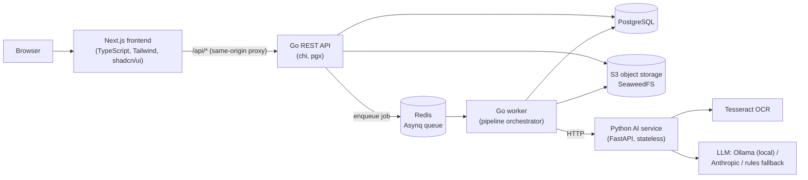
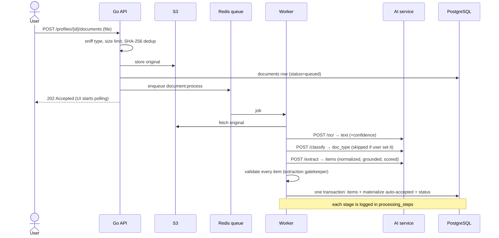
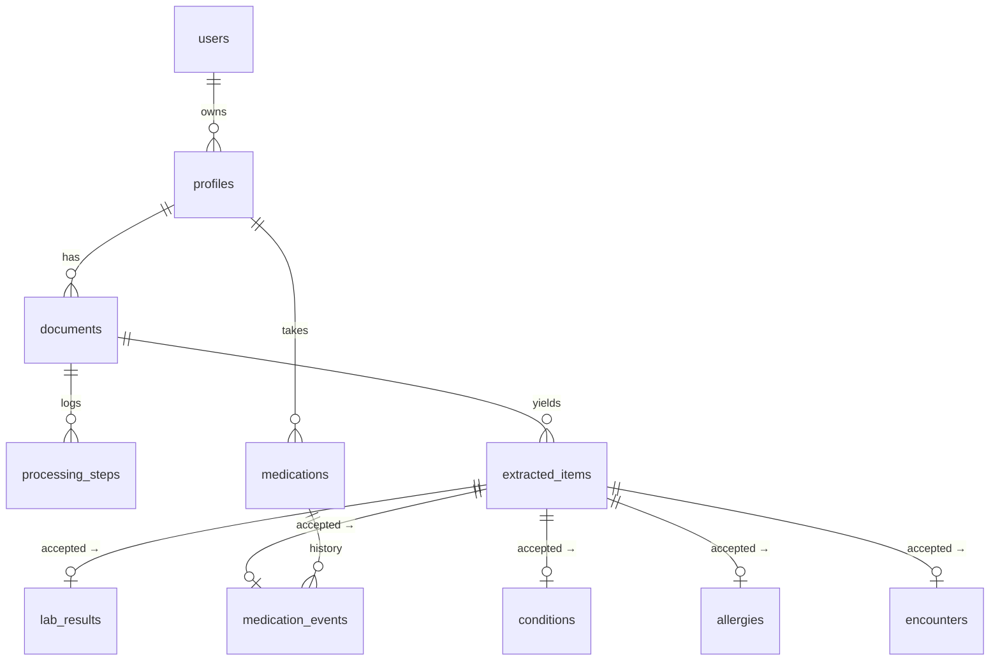

# MedVault — Architecture (Phase 1 + 2)

MedVault turns a pile of medical documents (prescriptions, lab reports,
discharge summaries — PDFs or phone photos) into a **structured, traceable,
longitudinal health record**. AI is one subsystem; the rest is ordinary,
carefully engineered software.

## 1. Components

| Component | Responsibility | Why this choice |
|---|---|---|
| **Next.js** | UI, session-cookie proxy to the API | Same-origin requests → httpOnly cookie auth with no CORS |
| **Go API** | Auth, profiles, uploads, record queries, review | Fast, typed, simple concurrency; one binary |
| **Go worker** | Runs the document pipeline from the queue | Long AI calls never block HTTP requests; retries with backoff |
| **PostgreSQL** | Metadata, OCR text (full-text search), structured record | Relational model fits medical data; `tsvector` search |
| **Redis + Asynq** | Durable job queue | Retries, timeouts, at-least-once delivery |
| **S3 (SeaweedFS)** | Original files | Keeps large blobs out of the DB; swappable for AWS S3 |
| **Python AI service** | OCR, classification, extraction, normalization | Python owns the ML ecosystem; stateless → easy to scale/replace |

A **modular monolith** (one API binary + one worker binary sharing packages)
was chosen over microservices: the team gets clear module boundaries without
distributed-systems overhead.

## 2. Document pipeline

Failures retry with growing delays (10 s, 40 s, 90 s). Between attempts the
document shows `queued` with an explanation; after the last attempt (or an
unrecoverable error such as a corrupt file) it becomes `failed`, and the user
can press **Reprocess**.

## 3. AI reliability design (the Phase 2 contribution)

The LLM is treated as an **untrusted, error-prone component**:

1. **LLM transcribes, code interprets.** The LLM only locates fields and
   copies them as written (`"1-0-1"`, `"HGB"`, `"132 g/L"`). Deterministic
   normalizers map brands to generics, units to canonical units, and shorthand to
   frequencies. (In our benchmark a 9B model misread `1-0-1` as three times
   daily, which is why this design was chosen.)
2. **Grounding check.** Every item carries the verbatim `source_text`; if
   that text is not actually in the OCR output the item is marked ungrounded.
3. **Confidence scoring.** Provider confidence, grounding, normalization
   success and OCR quality combine into one score.
4. **Gatekeeper validation (Go).** Types, enums, ranges, dates and required
   fields are validated again on the Go side; unknown fields are dropped.
5. **Human-in-the-loop.** Only items with `confidence ≥ 0.85`, grounded and with
   no issues are auto-accepted. Everything else waits on the Review screen,
   where corrected values go through the same validation.
6. **Staging vs record.** `extracted_items` is a staging table; only accepted
   items are materialized into `lab_results`, `medication_events`, etc.
   Rejecting an accepted item removes it from the record again.
7. **Traceability.** Every fact links to its source document and the quote it
   came from.
8. **Offline fallback.** A rules-based extractor runs with no LLM at all. It is
   used as a fallback, as the test oracle, and as the baseline in the
   evaluation.

## 4. Data model

- Dates of facts are nullable and fall back to the document date at query time,
  so correcting a document's date moves all its facts on the timeline.
- `medications` is one row per (profile, generic); every prescription mention is
  a `medication_event`, giving a full dose history. Phase 3 change detection
  builds on this.
- Unrecognized lab tests are kept under a `raw:<name>` code rather than being
  dropped.

## 5. Security & privacy

- Passwords: bcrypt (cost 12), with constant-time behaviour for unknown emails.
- Sessions: HS256 JWT in an `HttpOnly`, `SameSite=Lax` cookie (`Secure` in production).
- Authorization in SQL: every query joins to the owning user, so other
  users' resources return **404** (their existence is not revealed).
- Uploads: type detected from the content (not the extension), 20 MB limit,
  names sanitized, stored under random UUID keys.
- Served originals: `Content-Security-Policy: sandbox`, so an uploaded file can
  never run script in our origin.
- `Cache-Control: no-store` on API responses; logs contain IDs only, never
  medical content.
- Login/register rate limited per IP (10/min).
- All IDs are UUIDs and are validated before reaching SQL.

## 6. Testing

| Layer | What is tested |
|---|---|
| Go unit | validation gatekeeper, JWT/password, medication status rules, lab trends, timeline highlights |
| Go integration | real router + Postgres + pipeline with a fake AI: auth, isolation between users, upload validation, processing, review, timeline/labs/meds, reprocess, delete |
| Python | normalizers, frequency parser, classifier, rules extractor, OCR, API contract, LLM provider with mocked HTTP |
| Evaluation | labelled synthetic dataset → classification accuracy, lab/medication precision/recall/F1 per provider |
| Frontend | utility and component tests (Vitest), typecheck, lint, production build |
